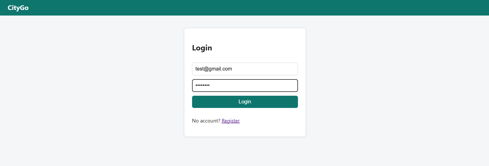
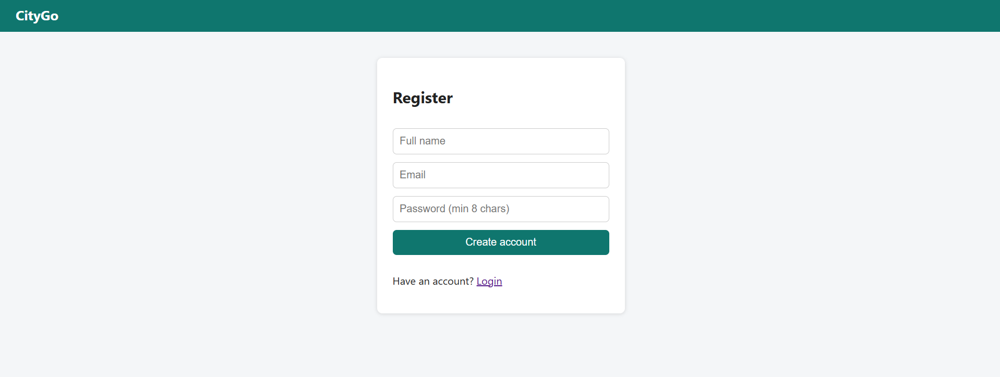
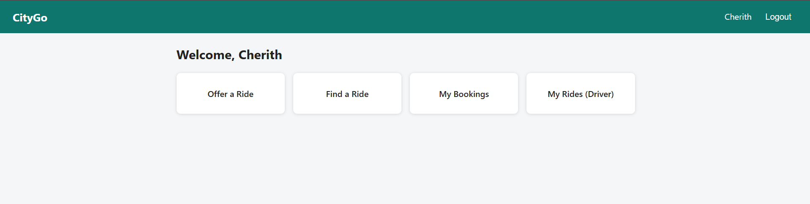
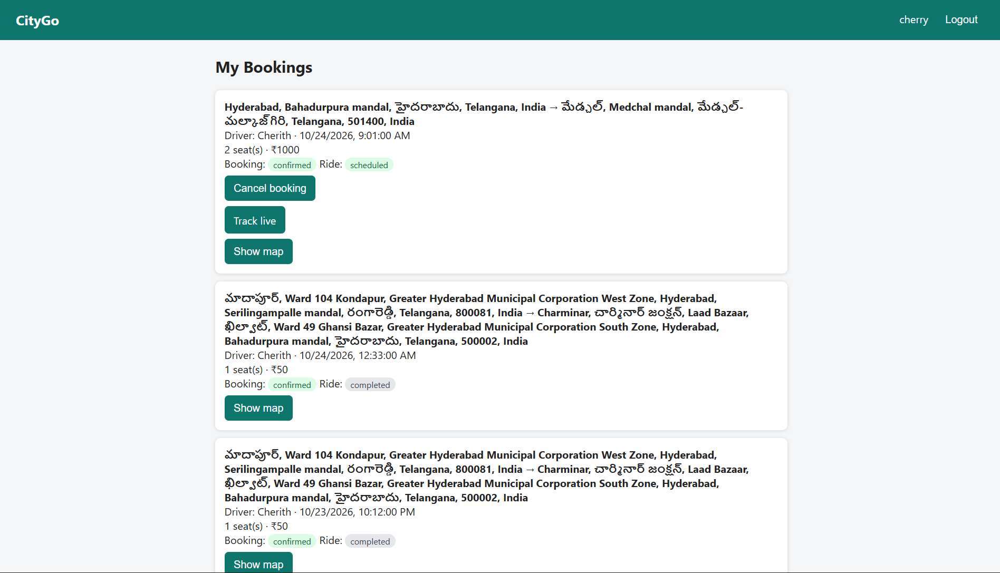
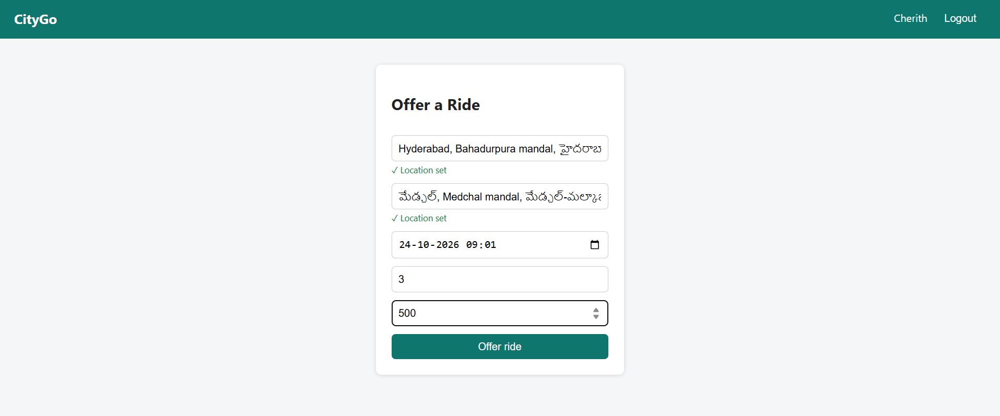
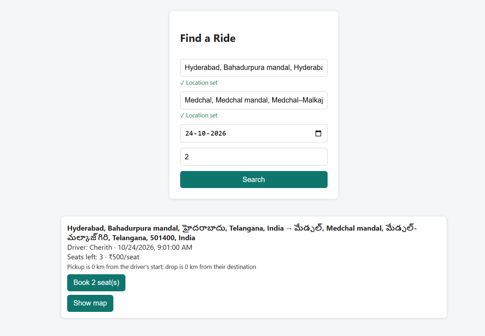
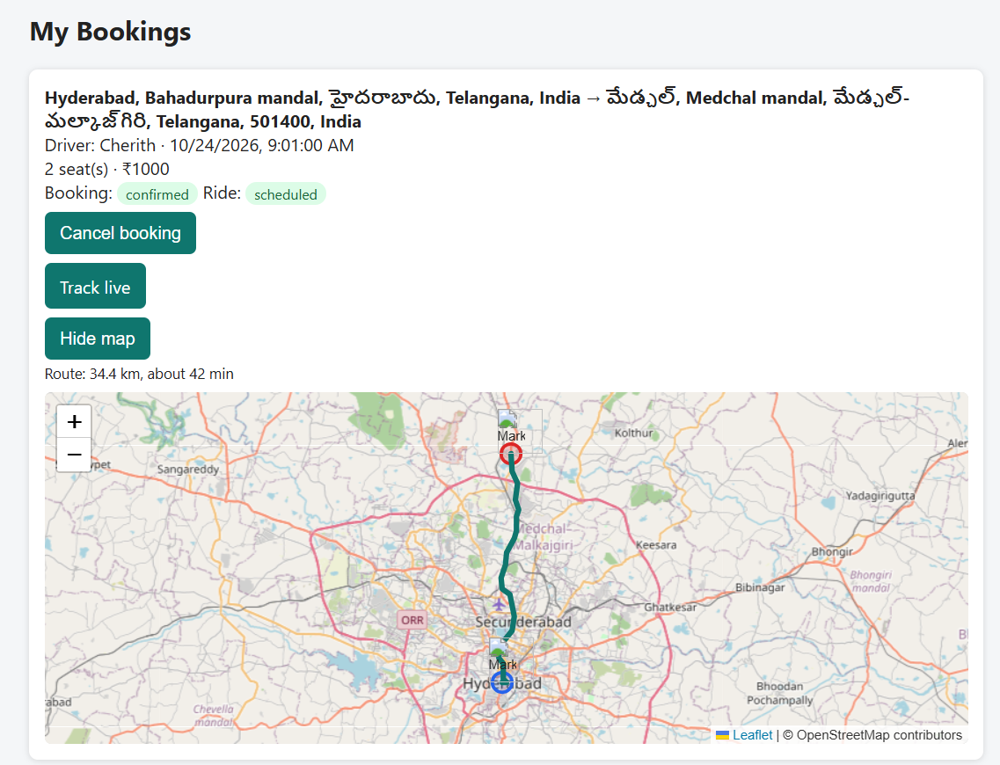
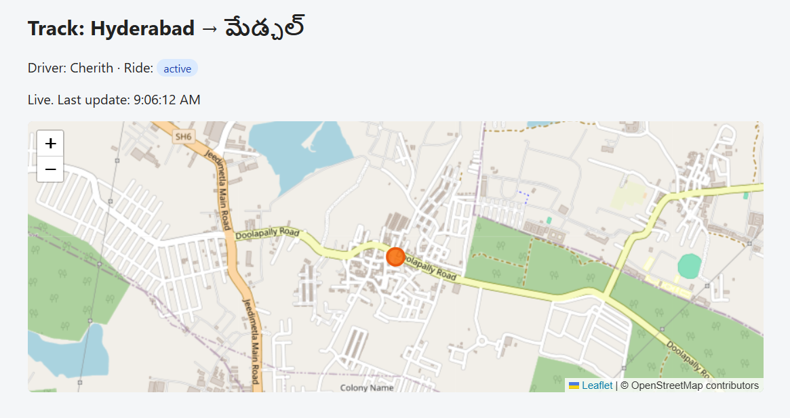
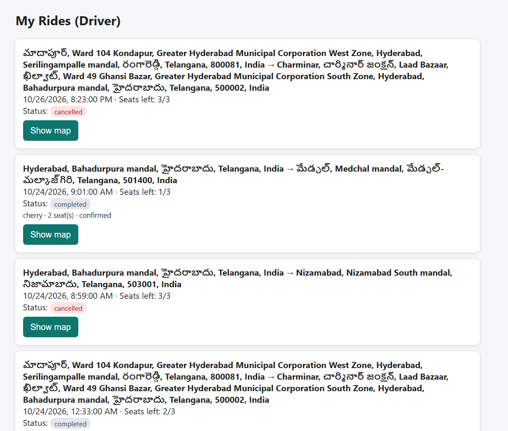

# CityGo – Intelligent Ride-Sharing System

CityGo is an intelligent ride-sharing platform designed to make urban transportation more affordable, convenient, and sustainable.

The platform connects people travelling in similar directions, allowing users to offer rides, search for available rides, book seats, and track rides in real time.

## Features

- User Registration and Login
- Secure Authentication
- Offer a Ride
- Search and Book Rides
- Manage Ride Bookings
- Driver Ride Management
- Interactive Maps
- Pickup and Destination Route Visualization
- Live GPS Driver Tracking

## Tech Stack

### Frontend
- React.js
- Vite
- JavaScript
- CSS
- Leaflet Maps

### Backend
- Python
- Flask
- Flask-JWT-Extended
- Flask-SocketIO

### Database
- SQLite

## Project Structure

    CityGo/
    ├── backend/
    │   ├── app.py
    │   ├── bookings.py
    │   ├── live.py
    │   ├── models.py
    │   ├── rides.py
    │   └── requirements.txt
    │
    ├── frontend/
    │   ├── public/
    │   ├── src/
    │   │   ├── components/
    │   │   ├── pages/
    │   │   ├── App.jsx
    │   │   └── main.jsx
    │   └── package.json
    │
    ├── .gitignore
    └── README.md

## Project Objective

To provide an accessible ride-sharing solution that helps reduce individual travel costs, improve vehicle utilization, and encourage sustainable urban mobility.

## Future Scope

- Online Payment Integration
- Ride Ratings and Reviews
- Advanced Ride Matching
- Route Optimization

## Author

Sai Cherith Yerra

---

**CityGo – Making Every Ride Count.**

## Application Screenshots

### Login & Registration

### Dashboard

### Ride Booking

### Offer a Ride

### Search Rides

### Route Map

### Live GPS Tracking

### Driver Rides

### Booking & Ride Management

